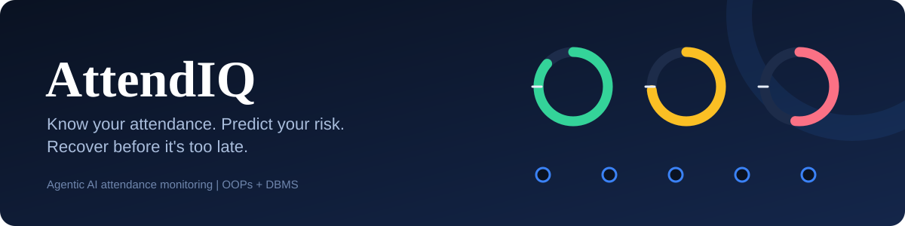
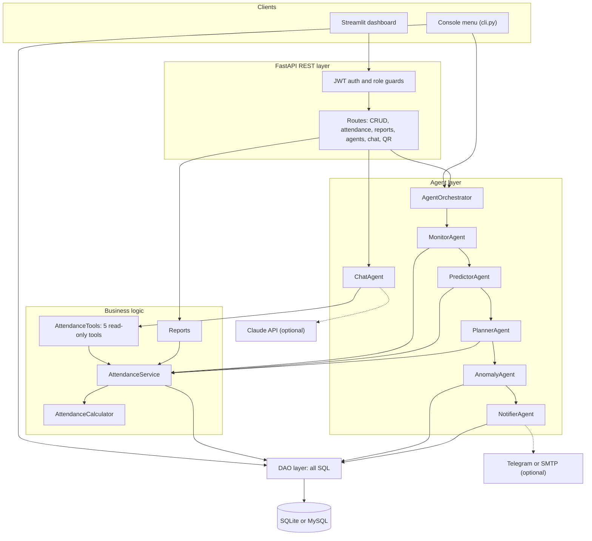
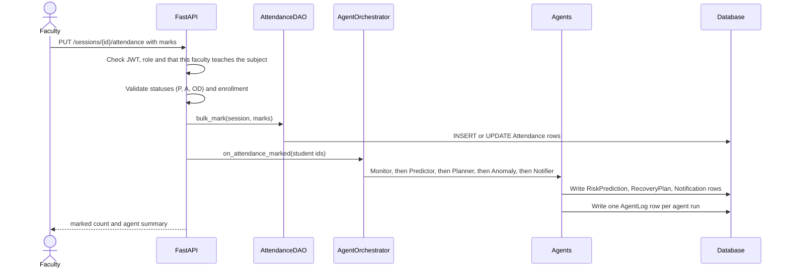
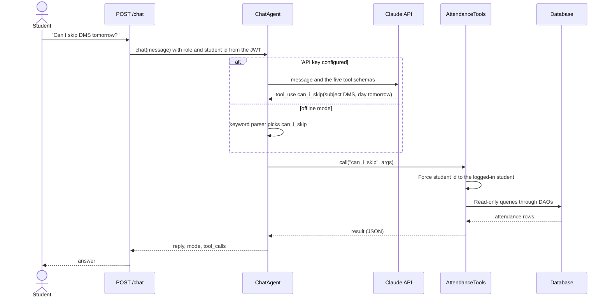
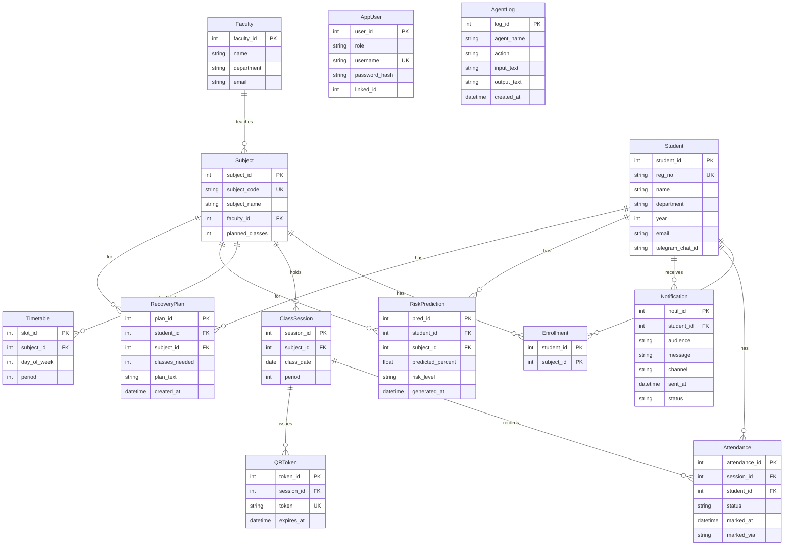
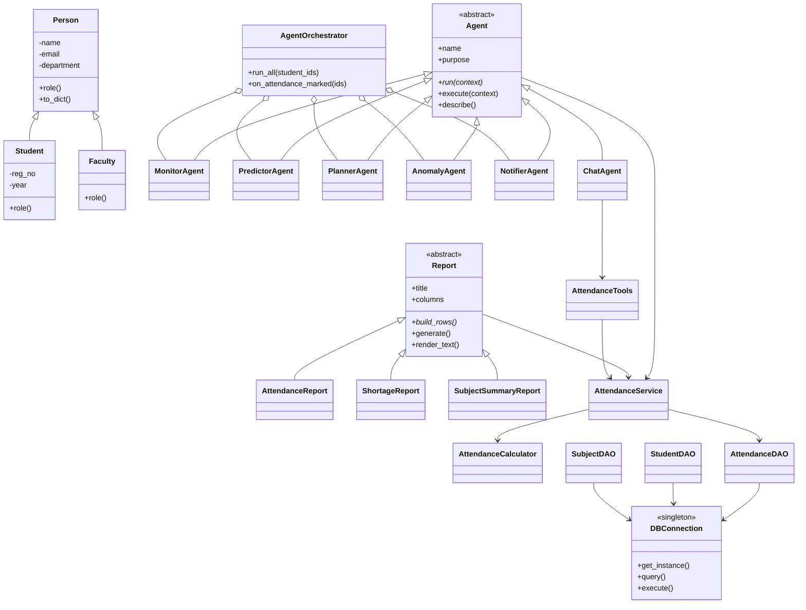

<p align="center">
  
</p>

<h3 align="center">Know your attendance. Predict your risk. Recover before it's too late.</h3>

<p align="center">
  
  
  
  
  
  
</p>

<p align="center">
  <a href="#quick-start">Quick start</a> ·
  <a href="#architecture">Architecture</a> ·
  <a href="#the-six-agents">Agents</a> ·
  <a href="#database-design">Database</a> ·
  <a href="#api-reference">API</a> ·
  <a href="#testing">Tests</a>
</p>

---

**AttendIQ** is an OOPs + DBMS project that calculates subject-wise attendance, predicts shortage risk, writes personalised recovery plans, flags suspicious patterns, and lets students and faculty ask questions in natural language. A team of autonomous agents sits on top of a normalised relational database, and the AI assistant can only act through a small set of **read-only, predefined tools**. It never writes SQL.

> Live demo: _add your deployed link here after deploying (see [Deployment](#deployment))._

## Table of contents

1. [Why AttendIQ](#why-attendiq)
2. [Features](#features)
3. [Tech stack](#tech-stack)
4. [Architecture](#architecture)
5. [The six agents](#the-six-agents)
6. [Attendance calculation engine](#attendance-calculation-engine)
7. [Database design](#database-design)
8. [OOP concepts demonstrated](#oop-concepts-demonstrated)
9. [Security and agent safety](#security-and-agent-safety)
10. [Quick start](#quick-start)
11. [Configuration](#configuration)
12. [Project structure](#project-structure)
13. [API reference](#api-reference)
14. [Screenshots](#screenshots)
15. [Testing](#testing)
16. [Deployment](#deployment)
17. [Team](#team)
18. [Roadmap](#roadmap)
19. [License and credits](#license-and-credits)

## Why AttendIQ

Students usually find out about an attendance shortage when it is already too late to recover. Faculty have no early-warning view of who is at risk, and proxy attendance can go unnoticed.

| Objective | How AttendIQ does it |
|---|---|
| Digitise attendance | Normalised relational schema, 13 tables, full CRUD |
| Make the rules visible | Percentage, classes needed to recover, safe skips, per subject |
| Look ahead | End-of-semester prediction with a Low / Medium / High / Critical risk level |
| Act early | Agents monitor, plan, detect anomalies and send alerts automatically |
| Ask in plain language | Chat assistant that works only through approved, read-only tools |
| Help faculty | Shortage list, subject-wise summary, escalations and an agent audit log |

## Features

Status labels: **Implemented**, **Partial**, **Planned**.

| Feature | Status | Notes |
|---|---|---|
| Student, faculty, subject, enrollment and class-session CRUD | Implemented | REST API; student CRUD also in the console menu |
| Attendance marking: Present (P), Absent (A), On Duty (OD) | Implemented | API, console menu and dashboard; marks can be edited and deleted |
| Subject-wise percentage, classes needed to recover, safe skips | Implemented | [`calculator.py`](attendiq/service/calculator.py) |
| Shortage and summary reports (SQL joins and aggregates) | Implemented | `GET /reports/{kind}` and console menu |
| Role-based login (student, faculty, admin) | Implemented | JWT, 12-hour tokens |
| Natural-language assistant | Implemented | Offline rule-based mode always works; Claude tool-calling mode needs `ANTHROPIC_API_KEY` |
| What-if simulation | Implemented | "What if I miss 3 classes in OS?" |
| End-of-semester risk prediction | Implemented | Transparent heuristic, **not** a trained ML model |
| Personalised recovery plans | Implemented | Stored per student and subject |
| Alerts (Telegram, email) | Implemented in code | Not exercised against live services; without credentials alerts are stored as `simulated` |
| Escalation to faculty | Implemented | Shortage in 2+ subjects, or a Critical prediction |
| Agent execution log | Implemented | `AgentLog` table, `GET /agents/log`, dashboard page |
| QR-code attendance | Implemented | 90-second tokens; no geofencing |
| Anomaly detection | Partial | Three rules only (see [AnomalyAgent](#anomalyagent)) |
| Charts | Partial | Bar charts in the dashboard; no heatmaps yet |
| Background scheduler | Planned | Agents run on events and via `POST /agents/run`; no cron job |
| Weekly AI-written faculty summary | Planned | |
| Voice input | Planned | |

## Tech stack

Verified against the source code and [`requirements.txt`](requirements.txt).

| Layer | Technology | Purpose |
|---|---|---|
| Language | Python 3 (tested on 3.12) | Whole project |
| API | FastAPI, Uvicorn, Pydantic | REST endpoints, request validation, auto-generated docs at `/docs` |
| Dashboard | Streamlit, requests, pandas | Student and faculty UI that talks to the API |
| Database | SQLite (default) or MySQL / MariaDB | Persistent storage; the same SQL runs on both |
| DB drivers | `sqlite3` (built in), `mysql-connector-python` | Parameterised queries through the `DBConnection` singleton |
| AI assistant | Anthropic Python SDK (Claude tool calling) | Optional; chooses which approved tool to call |
| Prediction | Pure Python | Weighted recent and overall attendance rate; scikit-learn is **not** used |
| Authentication | PyJWT and salted PBKDF2-SHA256 hashes | Login tokens and password storage |
| Notifications | Telegram Bot API, SMTP (standard library) | Optional alert delivery |
| QR | `qrcode` | Draws the QR image in the dashboard (optional) |
| Testing | pytest, httpx | Unit, integration and API tests |

## Architecture



Dotted lines are optional external services. The layers only talk downwards: the API never writes SQL, agents never touch the database except through DAOs, and the LLM only ever reaches data through `AttendanceTools`.

### Data flow: faculty saves attendance



The agents run **synchronously** inside the request. An agent that crashes is caught, logged to `AgentLog`, and does not stop attendance from being saved. Agents only read attendance; they never change marks.

## The six agents

All agents inherit the abstract class `Agent` in [`agents/base.py`](attendiq/agents/base.py). Subclasses override `run(context)`. The concrete `execute()` method is a **template method**: it calls `run()`, writes an `AgentLog` row, and contains any exception. `describe()` returns the agent's `name` and `purpose` class attributes.

| Agent | Trigger | Reads | Produces |
|---|---|---|---|
| [MonitorAgent](#monitoragent) | After attendance is saved, or `POST /agents/run` | Attendance, sessions | Status per student and subject, and the alert list |
| [PredictorAgent](#predictoragent) | After Monitor | Attendance history, `planned_classes` | `RiskPrediction` rows |
| [PlannerAgent](#planneragent) | After Predictor | Monitor stats | `RecoveryPlan` rows |
| [AnomalyAgent](#anomalyagent) | After Planner | Attendance, sessions | List of findings (returned and logged) |
| [NotifierAgent](#notifieragent) | After Anomaly | Alerts and predictions | `Notification` rows and optional Telegram or email |
| [ChatAgent](#chatagent) | `POST /chat` | Attendance through tools | A text reply and the list of tools used |

### MonitorAgent
Recalculates percentages and classifies every student and subject as Safe, Warning or Shortage using `AttendanceCalculator`. It builds the alert list the other agents work from.

### PredictorAgent
Estimates the end-of-semester percentage:

```
blended_rate        = 0.6 x (rate over the last 10 classes) + 0.4 x (overall rate)
predicted_attended  = attended + blended_rate x remaining_classes
predicted_percent   = predicted_attended / planned_classes x 100
```

Risk levels: **Critical** when even perfect attendance from now on cannot reach the threshold, **High** below 75% predicted, **Medium** below 80%, otherwise **Low**. It is a transparent heuristic that is easy to explain and easy to replace with a trained model later. It uses `Subject.planned_classes`, not the timetable, to count remaining classes.

### PlannerAgent
Writes a plain-language recovery plan for every subject in Shortage or Warning, for example: attend the next N classes without a miss, how many classes remain, and which other subjects still have safe skips. Plans for recovered subjects are removed.

### AnomalyAgent
Rule-based and deterministic. It currently flags:
1. A student marked **Present in two different subjects in the same period** (impossible).
2. A session of 10 or more students with **100% present**.
3. A student whose **OD marks exceed 30%** of their present marks in a subject.

Bulk-marking timing and location mismatch are **not** implemented because the schema does not capture the data they need.

### NotifierAgent
Turns alerts into messages. Delivery order: Telegram (token and chat id set), then email (SMTP and student email set), otherwise the message is stored with status `simulated`. Identical messages are suppressed for the rest of the day. Students in shortage in two or more subjects, or with a Critical prediction, are also escalated to faculty (stored with `audience = 'faculty'`).

### ChatAgent
Understands a question and calls one of five tools in `AttendanceTools`: `get_attendance`, `what_if`, `can_i_skip`, `list_shortage`, `timetable`. With `ANTHROPIC_API_KEY` set, Claude chooses the tool (tool calling). Without a key, or if the API call fails, an offline rule-based parser maps the question to the same tools.



## Attendance calculation engine

Implemented in [`attendiq/service/calculator.py`](attendiq/service/calculator.py). Let `a` = classes attended (**P + OD**) and `t` = total classes held, with threshold `T` = 75 by default.

| Quantity | Formula | At T = 75 |
|---|---|---|
| Percentage | `a / t x 100` | |
| Classes needed to recover | `max(0, ceil((T*t - 100*a) / (100 - T)))` | `max(0, 3t - 4a)` |
| Safe skips | `max(0, floor(100*a / T - t))` | `max(0, floor(4a/3 - t))` |

**Worked example:** attended 30 of 44 classes is 68.18%. Recovery needs `3 x 44 - 4 x 30 = 12` consecutive classes, and `42 / 56 = 75%` confirms it. With 36 of 44 attended, `floor(4 x 36 / 3 - 44) = 4` classes can still be skipped (`36 / 48 = 75%`).

Fractions are used internally, so there are no floating-point rounding errors at the boundary.

**Status rules and edge cases (actual behaviour):**

| Condition | Status |
|---|---|
| `t = 0` | `No data` (percentage 0, classes needed 0, safe skips 0) |
| below 75% | Shortage |
| 75% up to but **not including** 80% | Warning |
| 80% or above | Safe |

> **Note:** the original project brief said "above 80% is Safe". The code treats **exactly 80.00% as Safe**. Exactly 75.00% is a Warning, not a Shortage. Both limits are configurable with `ATTENDIQ_THRESHOLD` and `ATTENDIQ_WARNING_BAND`.

## Database design

Two schema files with identical structure: [`db/schema_sqlite.sql`](db/schema_sqlite.sql) and [`db/schema_mysql.sql`](db/schema_mysql.sql). `python -m attendiq.seed` creates the tables automatically.



### Tables

| Table | Key | Important constraints | Purpose |
|---|---|---|---|
| `Student` | `student_id` | `reg_no` UNIQUE NOT NULL | Student identity |
| `Faculty` | `faculty_id` | | Faculty identity |
| `Subject` | `subject_id` | `subject_code` UNIQUE; `faculty_id` FK, ON DELETE SET NULL; `planned_classes` default 60 | A course and its teacher |
| `Enrollment` | (`student_id`, `subject_id`) | Both FKs, ON DELETE CASCADE | Which student takes which subject |
| `ClassSession` | `session_id` | UNIQUE (`subject_id`, `class_date`, `period`) | One class that was held |
| `Attendance` | `attendance_id` | UNIQUE (`session_id`, `student_id`); `status` is P, A or OD (CHECK in SQLite, ENUM in MySQL) | One mark per student per class |
| `Timetable` | `slot_id` | UNIQUE (`day_of_week`, `period`) | Weekly slots (one timetable for the whole class) |
| `AppUser` | `user_id` | `username` UNIQUE; role is student, faculty or admin | Login accounts with hashed passwords |
| `Notification` | `notif_id` | FK to `Student`, CASCADE | Alert history for students and faculty |
| `RiskPrediction` | `pred_id` | UNIQUE (`student_id`, `subject_id`) | Latest prediction per pair |
| `RecoveryPlan` | `plan_id` | FKs, CASCADE | Latest plan per pair |
| `AgentLog` | `log_id` | | Audit trail of agent runs and chats |
| `QRToken` | `token_id` | `token` UNIQUE; FK to `ClassSession` | Short-lived QR attendance tokens |

### Normalisation

* **1NF:** every column is atomic; there are no repeating groups. Attendance is one row per student per class, not a list inside a column.
* **2NF:** tables with composite keys have no partial dependencies. `Enrollment` has no non-key columns. In `Attendance` the natural key is (`session_id`, `student_id`), and `status`, `marked_at` and `marked_via` depend on **both** parts.
* **3NF:** no non-key column depends on another non-key column. `Attendance` does not store the subject or date because they are determined by `session_id` and live in `ClassSession`. The teacher is stored once, in `Subject.faculty_id`. `Student.department` is a plain string; since there is no `Department` table, there is no transitive dependency yet.

**Deliberate exceptions and known gaps:**
* `RiskPrediction` and `RecoveryPlan` hold **derived** data, cached on purpose so dashboards do not recompute it.
* `Notification.message` stores a text snapshot of what was sent, on purpose.
* `AppUser.linked_id` points to either a student or a faculty row depending on `role`, so it has **no foreign key**. This is a referential-integrity gap.
* `Timetable` assumes a single section; it has no class or section column.

## OOP concepts demonstrated

| Concept | Where it is implemented |
|---|---|
| **Encapsulation** | Private fields with validating properties in [`model/person.py`](attendiq/model/person.py): `Person.name`, `Person.email`, `Student.year`, read-only `Student.reg_no` |
| **Inheritance** | `Person` to `Student` and `Faculty`; `Agent` to six agents; `Report` to three reports |
| **Abstraction** | Abstract `Agent` ([`agents/base.py`](attendiq/agents/base.py)) with abstract `run()`; abstract `Report` ([`report/reports.py`](attendiq/report/reports.py)) with abstract `title`, `columns` and `build_rows()` |
| **Polymorphism** | Every agent overrides `run()`; every report overrides `build_rows()`; `Person.role()` returns a different value per subclass |
| **Template Method** | `Agent.execute()` (logging and error containment) and `Report.generate()` |
| **Singleton** | `DBConnection` in [`util/db.py`](attendiq/util/db.py) |
| **DAO pattern** | All SQL lives in [`attendiq/dao/`](attendiq/dao); models and services never build SQL |

> The brief mentions `describe()` and `generateReport()`. In the code, `describe()` is a concrete method shared by all agents (it reads each class's `name` and `purpose`), and reports override `build_rows()` while the shared `generate()` assembles the result.



## Security and agent safety

What the code **actually enforces**:

| Rule | Where | Verified by |
|---|---|---|
| Passwords are salted PBKDF2-SHA256 hashes, never stored in plain text | `UserDAO` | `test_passwords_hashed_and_verified` |
| Every route except login needs a valid JWT; role guards return 403 | `api/auth.py`, `require()` | `test_login_and_auth_required`, `test_student_is_pinned_to_own_data` |
| Faculty can only create sessions, mark, edit, delete marks and issue QR codes for **subjects they teach** | `can_teach()` in `api/app.py` | `test_faculty_cannot_touch_other_facultys_subject` |
| A student is **always pinned to their own data** server-side | `own_or_any()` and `AttendanceTools._student()` | `test_student_is_pinned_to_own_data`, `test_student_cannot_see_others_or_list_shortage` |
| Chat is read-only: the assistant has five read-only tools and no write tool | `agents/chat.py` | `test_tools_reject_unknown_tool_and_bad_args` |
| Agents never change attendance marks | `agents/*` | `test_agents_never_change_attendance_marks` |
| Every agent run and chat is written to `AgentLog`; a crashing agent is contained | `Agent.execute()` | `test_agent_failure_is_contained_and_logged` |
| SQL values are passed as bound parameters (`%s` placeholders) | `dao/*`, `util/db.py` | code review |
| Input validation: Pydantic bodies, model validators, status whitelist (P, A, OD), enrollment check, date check | `api/app.py`, `model/*` | `test_admin_student_crud`, `test_faculty_marks_attendance_and_agents_react` |

**The security boundary between the model and the database:** the LLM can only name one of five tools and supply arguments. Role rules are enforced **inside the tools**, not in the prompt. The chat path has no code that executes model-written SQL. The system prompt also tells the model to treat tool output as data, but that is a soft control; the hard control is the fixed tool list.

**Known gaps (not implemented):**
* No CORS configuration, rate limiting or login lockout.
* The default `ATTENDIQ_SECRET` and the seeded demo passwords are for development only and must be changed before any real use.
* JWTs cannot be revoked before they expire (12 hours).
* The brief's rule "data-changing agent actions require faculty confirmation" has no code path today because agents never change attendance. If write-capable agents are added, a confirmation step is needed.
* QR tokens last 90 seconds, but a screenshot can still be forwarded to a friend. There is no geofencing.
* `AgentLog` stores chat messages, and the database holds names and emails; apply your institution's privacy rules.
* The LLM mode is covered by a mocked-client test only; it has not been run against the live Claude API in this repository's tests.

## Quick start

**Prerequisites:** Python 3 (tested on 3.12) and `pip`. MySQL or MariaDB is optional.

```bash
git clone <your-repo-url> attendiq
cd attendiq

python -m venv .venv
# macOS / Linux
source .venv/bin/activate
# Windows PowerShell
.venv\Scripts\Activate.ps1

pip install -r requirements.txt
python -m attendiq.seed
```

`seed` creates the tables and loads demo data: 4 faculty, 5 subjects, 12 students and 150 classes.

**Option A: console menu** (no server needed):

```bash
python -m attendiq.cli
```

**Option B: API and dashboard** (two terminals, both with the virtual environment active):

```bash
uvicorn attendiq.api.app:app --reload      # API on http://127.0.0.1:8000  (docs at /docs)
streamlit run ui/dashboard.py              # dashboard on http://localhost:8501
```

**Demo logins** (development only):

| Role | Username | Password |
|---|---|---|
| Admin | `admin` | `admin123` |
| Faculty | `f1` to `f4` | `faculty123` |
| Student | registration number in lowercase, e.g. `rec24cs012` | `student123` |

`rec24cs012` is a heavy-shortage student, good for demos. `rec24cs001` is safe. Faculty `f1` teaches DBMS, `f2` teaches OOPS and CN, `f3` teaches DMS and `f4` teaches OS.

### Using MySQL instead of SQLite

```sql
CREATE DATABASE attendance_tracker;
```

Set these environment variables, then run `python -m attendiq.seed` again:

```bash
ATTENDIQ_DB=mysql
MYSQL_HOST=localhost
MYSQL_USER=root
MYSQL_PASSWORD=your_password
MYSQL_DATABASE=attendance_tracker
```

### Using a `.env` file

`.env.example` lists every variable. `config.py` loads a `.env` file **only if `python-dotenv` is installed**, and it is not in `requirements.txt`:

```bash
pip install python-dotenv
cp .env.example .env        # Windows: copy .env.example .env
```

### Troubleshooting

| Problem | Fix |
|---|---|
| `Cannot reach the API` in the dashboard | Start Uvicorn first, or set `ATTENDIQ_API` to the API address |
| `ModuleNotFoundError: attendiq` | Run commands from the repository root |
| `mysql.connector` import error | `pip install mysql-connector-python`, and check `ATTENDIQ_DB=mysql` is intended |
| Login fails after reseeding | `python -m attendiq.seed --reset` (SQLite only) recreates all data and accounts |
| PowerShell blocks the venv script | `Set-ExecutionPolicy -Scope Process Bypass`, then activate again |
| Alerts show status `simulated` | Expected until Telegram or SMTP variables are set |

## Configuration

| Variable | Default | Purpose |
|---|---|---|
| `ATTENDIQ_DB` | `sqlite` | `sqlite` or `mysql` |
| `ATTENDIQ_SQLITE_PATH` | `attendiq.db` | SQLite file |
| `MYSQL_HOST` `MYSQL_PORT` `MYSQL_USER` `MYSQL_PASSWORD` `MYSQL_DATABASE` | localhost, 3306, root, empty, `attendance_tracker` | MySQL connection |
| `ATTENDIQ_THRESHOLD` | `75` | Minimum required attendance % |
| `ATTENDIQ_WARNING_BAND` | `80` | Below this (and at or above the threshold) is Warning |
| `ATTENDIQ_SECRET` | `dev-secret-change-me` | JWT signing key. **Change it.** |
| `ATTENDIQ_PBKDF2_ITER` | `200000` | Password hashing cost |
| `ATTENDIQ_AUTOSEED` | unset | Set to `1` to seed demo data when the API starts |
| `ANTHROPIC_API_KEY` | empty | Enables Claude tool calling in the ChatAgent |
| `ATTENDIQ_MODEL` | `claude-sonnet-5-5` | Model used by the ChatAgent |
| `TELEGRAM_BOT_TOKEN` | empty | Telegram alerts (students also need a `telegram_chat_id`) |
| `SMTP_HOST` `SMTP_PORT` `SMTP_USER` `SMTP_PASSWORD` `SMTP_FROM` | empty, 587 | Email alerts |
| `ATTENDIQ_API` | `http://127.0.0.1:8000` | API address used by the Streamlit dashboard |
| `ATTENDIQ_TEST_DB` | `sqlite` | Set to `mysql` to run the tests against MySQL |

Never commit real keys. `.env` is already in `.gitignore`.

## Project structure

```text
attendiq/
├── attendiq/
│   ├── agents/          base.py, monitor.py, predictor.py, planner.py, anomaly.py,
│   │                    notifier.py, chat.py, orchestrator.py
│   ├── api/             app.py (routes), auth.py (JWT and role guards)
│   ├── dao/             base.py, people.py, academic.py, ai.py   (all SQL lives here)
│   ├── model/           person.py (Person, Student, Faculty), academic.py
│   ├── report/          reports.py (Report, AttendanceReport, ShortageReport, SubjectSummaryReport)
│   ├── service/         calculator.py, attendance_service.py
│   ├── util/            db.py (DBConnection singleton)
│   ├── cli.py           console menu
│   ├── config.py        environment-based settings
│   └── seed.py          demo data and accounts
├── db/                  schema_sqlite.sql, schema_mysql.sql
├── ui/                  dashboard.py (Streamlit)
├── tests/               conftest.py, test_calculator.py, test_core.py, test_chat.py, test_api.py
├── assets/              banner.svg, screenshots/
├── .env.example
├── requirements.txt
└── README.md
```

Entry points: `python -m attendiq.seed`, `python -m attendiq.cli`, `uvicorn attendiq.api.app:app`, `streamlit run ui/dashboard.py`.

## API reference

Interactive docs are generated at **`/docs`** (Swagger UI) while the API is running. Authenticate with `Authorization: Bearer <token>`.

Roles: **A** = admin, **F** = faculty (own subjects only where noted), **S** = student.

| Method | Route | Purpose | Roles |
|---|---|---|---|
| POST | `/auth/login` | Get a JWT | public |
| GET | `/me` | Current user and profile | any |
| GET | `/students` | List students | A, F |
| POST | `/students` | Create student (201) | A |
| GET | `/students/{id}` | Get student | A, F, S (own only) |
| PUT | `/students/{id}` | Update student | A |
| DELETE | `/students/{id}` | Delete student and their attendance (204) | A |
| GET | `/faculty` | List faculty | A, F |
| POST / PUT / DELETE | `/faculty`, `/faculty/{id}` | Create, update, delete faculty | A |
| GET | `/subjects` | List subjects | any |
| POST / PUT / DELETE | `/subjects`, `/subjects/{id}` | Create, update, delete subject | A |
| POST | `/subjects/{id}/enroll` | Enroll a student (body: `student_id`) | A |
| GET | `/timetable` | Weekly slots | any |
| POST | `/sessions` | Create a class session (returns roster) | A, F (own subject) |
| GET | `/sessions/{id}/roster` | Enrolled students with their marks | A, F (own subject) |
| PUT | `/sessions/{id}/attendance` | Mark or edit attendance; triggers the agents | A, F (own subject) |
| DELETE | `/sessions/{id}/attendance/{student_id}` | Remove one mark (204) | A, F (own subject) |
| GET | `/attendance/summary` | Per-subject stats (`student_id`, `subject_id` filters) | any (S pinned to self) |
| POST | `/sessions/{id}/qr` | Issue a 90-second QR token | A, F (own subject) |
| POST | `/attendance/qr-scan` | Mark yourself present with a token | S |
| GET | `/reports/attendance` | One student's report | any (S pinned to self) |
| GET | `/reports/shortage`, `/reports/subject-summary` | Faculty reports | A, F |
| POST | `/agents/run` | Run the full agent pipeline now | A, F |
| GET | `/agents` | Describe the agents | any |
| GET | `/agents/log` | Agent audit log (`limit`, `agent` filters) | A, F |
| GET | `/predictions`, `/plans` | Risk predictions, recovery plans | any (S pinned to self) |
| GET | `/notifications` | Alerts (students see only their own) | any |
| POST | `/chat` | Ask the assistant | any |

**Error codes:** `400` invalid input (bad status, date, year, or unenrolled student), `401` missing or invalid token, `403` wrong role or not your subject, `404` record not found, `409` duplicate (for example a repeated `reg_no`).

<details>
<summary><b>Request and response examples</b></summary>

**Login**

```bash
curl -X POST http://127.0.0.1:8000/auth/login \
  -H "content-type: application/json" \
  -d '{"username":"f1","password":"faculty123"}'
```
```json
{"access_token": "<jwt>", "token_type": "bearer", "role": "faculty", "linked_id": 1}
```

**Mark attendance**

```bash
curl -X PUT http://127.0.0.1:8000/sessions/1/attendance \
  -H "Authorization: Bearer <jwt>" -H "content-type: application/json" \
  -d '{"marks": {"1": "P", "2": "A", "3": "OD"}}'
```
```text
{"marked": 3, "agents": {"MonitorAgent": {...}, "PredictorAgent": {...}, "PlannerAgent": {...},
 "AnomalyAgent": {...}, "NotifierAgent": {...}, "findings": [...]}}
```
The contents of each agent summary depend on your data.

**Chat**

```bash
curl -X POST http://127.0.0.1:8000/chat \
  -H "Authorization: Bearer <student-jwt>" -H "content-type: application/json" \
  -d '{"message":"how many classes do I need in OS?"}'
```
```json
{
  "reply": "Lakshmi Priya (REC24CS012) - threshold 75%\n- Operating Systems: 43.33% (13/30) [Shortage] - attend the next 38 classes to recover.",
  "mode": "offline",
  "tool_calls": [{"tool": "get_attendance", "input": {"subject": "OS"}}]
}
```
`mode` is `llm` when Claude answered and `offline` when the rule-based parser did.

</details>

## Screenshots

No screenshots are committed yet. Capture these from the running app, save them in `assets/screenshots/`, and then replace this table with images (``).

| Priority | File name | What to capture |
|---|---|---|
| 1 | `student-dashboard.png` | Logged in as `rec24cs012`: metrics, chart, recovery plan |
| 2 | `chat-assistant.png` | "Can I skip DMS tomorrow?" and a what-if question |
| 3 | `faculty-overview.png` | Logged in as `f1`: subject summary and shortage list |
| 4 | `mark-attendance.png` | Roster editor with P / A / OD selected |
| 5 | `agents-run.png` | Agents page after **Run all agents**, with findings |
| 6 | `audit-log.png` | Agent audit log table |
| 7 | `qr-attendance.png` | QR code generated by faculty |
| 8 | `login.png` | Login screen |

## Testing

```bash
pytest                              # 39 tests, in-memory SQLite, about 2 seconds
ATTENDIQ_TEST_DB=mysql pytest       # same tests against a real MySQL or MariaDB server
```

For MySQL set `MYSQL_HOST`, `MYSQL_USER`, `MYSQL_PASSWORD` and `MYSQL_DATABASE` first; the test database is wiped on every test.

| File | What it covers |
|---|---|
| `tests/test_calculator.py` (6) | Formulas, boundaries at exactly 75% and 80%, what-if, invalid threshold |
| `tests/test_core.py` (17) | Singleton, inheritance and validation, DAO CRUD, constraints, cascades, all agents, de-duplication, escalation, audit log, anomaly rule, reports |
| `tests/test_chat.py` (8) | Offline chat, role restrictions, tool rejection, the Claude tool-calling loop with a **mocked client**, and fallback when the API is down |
| `tests/test_api.py` (8) | Login, CRUD, role pinning, faculty marking, per-subject ownership, reports, QR flow, expired QR |

The validated main workflow is: faculty open a session, mark attendance, the agents run, and the student sees the updated percentage, plan and prediction (`test_faculty_marks_attendance_and_agents_react`, `test_reports_agents_and_chat_over_api`). No coverage percentage is published.

## Deployment

**Not configured yet.** This is a proposed strategy, not a deployed system.

1. **Database:** use a managed MySQL instance. Do not use SQLite on hosts with ephemeral disks, because data would be lost on restart.
2. **API:** deploy on a Python host such as Render or Railway.
   - Build: `pip install -r requirements.txt`
   - Start: `uvicorn attendiq.api.app:app --host 0.0.0.0 --port $PORT`
   - Set `ATTENDIQ_DB=mysql`, the `MYSQL_*` variables, a long random `ATTENDIQ_SECRET`, and optionally `ANTHROPIC_API_KEY`.
   - Create tables once with `python -m attendiq.seed` or the schema file, and **change or remove the demo accounts**.
3. **Dashboard:** host Streamlit (for example Streamlit Community Cloud) and set `ATTENDIQ_API` to the public API address.
4. **HTTPS and CORS:** serve over HTTPS. The Streamlit dashboard calls the API from its server, so CORS is not needed for it. If you add a browser-based frontend, add FastAPI's `CORSMiddleware` first.
5. **Verify:** open `/docs`, log in, mark attendance, and confirm a row appears in `AgentLog`.

## Team

Replace the placeholders with real names before publishing.

| Member | Role | Responsibility |
|---|---|---|
| _Name_ | Database and DAOs | Schema, sample data, queries, `DBConnection` |
| _Name_ | Core modules, authentication, API | CRUD, login, roles, REST API |
| _Name_ | Agents | `Agent` base class, Monitor, Predictor, Planner, Notifier, orchestration |
| _Name_ | ChatAgent, UI, documentation | Tool-calling assistant, dashboard, README, report |

## Roadmap

- [x] Normalised schema on SQLite and MySQL
- [x] Attendance engine, reports, JWT roles
- [x] Six agents with audit logging
- [x] QR attendance
- [x] 39 automated tests on two database engines
- [ ] Background scheduler for periodic agent runs
- [ ] Trained prediction model with proper evaluation
- [ ] Anomaly rules for timing and location (needs new data columns)
- [ ] Weekly AI-written faculty summary
- [ ] Heatmaps and trend charts
- [ ] Voice input
- [ ] Rate limiting, CORS configuration and token revocation
- [ ] Faculty-confirmation flow if write-capable agents are ever added
- [ ] Sections or classes in the timetable; a foreign key for `AppUser.linked_id`

## License and credits

No `LICENSE` file is present in this repository yet. Add one (for example MIT) before others reuse the code.

Built with [FastAPI](https://fastapi.tiangolo.com), [Uvicorn](https://www.uvicorn.org), [Pydantic](https://docs.pydantic.dev), [PyJWT](https://pyjwt.readthedocs.io), [Streamlit](https://streamlit.io), [mysql-connector-python](https://dev.mysql.com/doc/connector-python/), the [Anthropic Python SDK](https://github.com/anthropics/anthropic-sdk-python), [qrcode](https://github.com/lincolnloop/python-qrcode), [pytest](https://pytest.org) and [httpx](https://www.python-httpx.org).

Created as an OOPs and DBMS semester project.
